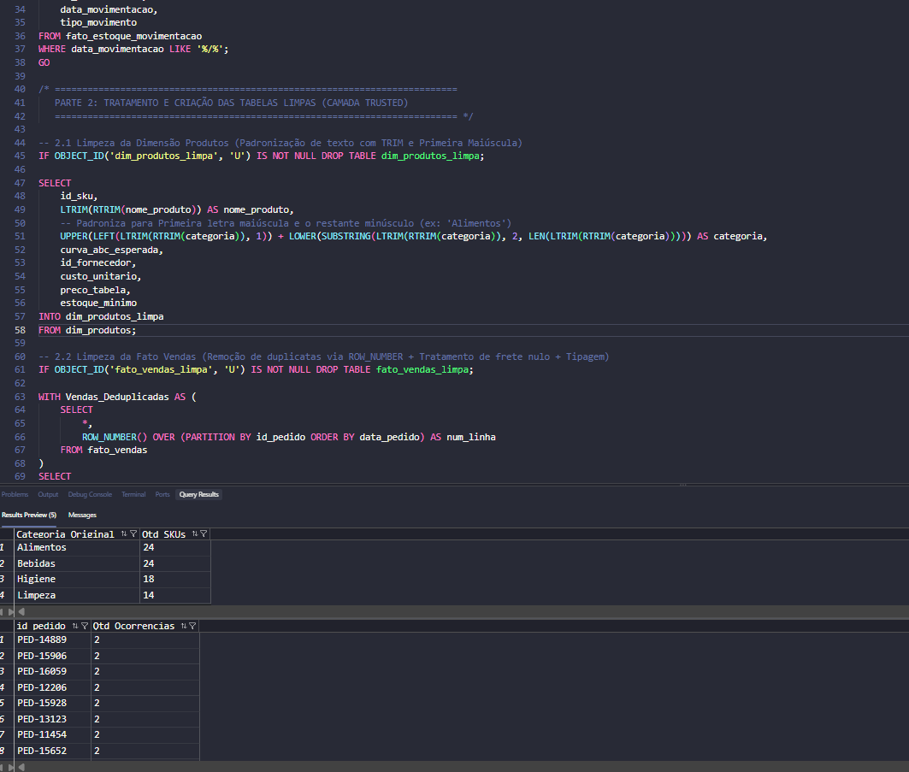
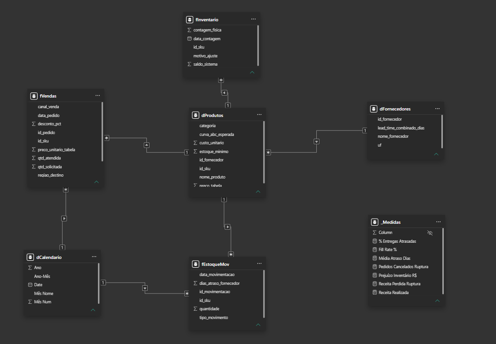
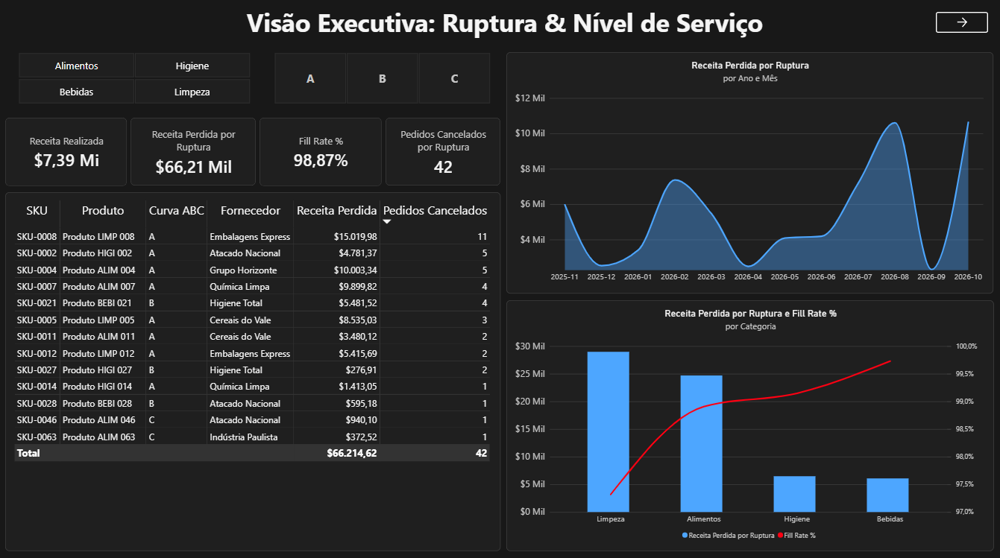
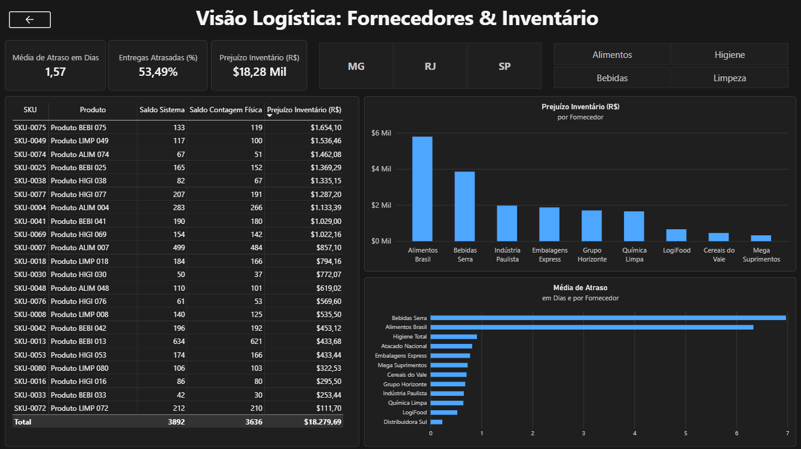

# 📦 Análise de Ruptura, Giro de Estoque e Eficiência Logística no Atacado


Projeto completo de Análise de Dados (**End-to-End**) focado na resolução de problemas reais da operação atacadista e de distribuição. O estudo abrange desde a engenharia de uma base relacional sintética em **Python**, passando pela auditoria e limpeza de dados com **T-SQL**, até a modelagem dimensional (*Star Schema*) e visualização executiva no **Power BI**.

---

## 🎯 Contexto e Problema de Negócio

Em operações de atacado e distribuição, o equilíbrio do estoque sustenta a margem e o nível de serviço da empresa:
* **Excesso de estoque** imobiliza capital de giro e eleva custos de armazenagem e avarias.
* **Ruptura de estoque** (falta de mercadoria no momento do pedido) gera perda direta de faturamento e desgaste comercial — especialmente quando atinge itens de **Curva A** (alta saída).

**Objetivos do Projeto:**
1. Quantificar o faturamento perdido por cancelamentos decorrentes de ruptura e medir o *Fill Rate* (taxa de atendimento) por categoria.
2. Identificar quais SKUs e curvas ABC concentram o maior prejuízo operacional.
3. Auditar o cumprimento de prazo (*Lead Time* e SLA) dos fornecedores que abastecem o centro de distribuição.
4. Cruzar o saldo sistêmico com a contagem física de galpão para mapear divergências e perdas de inventário.

---

## 🛠️ Stack Tecnológica e Arquitetura

* **Python (Bibliotecas Nativas `csv`, `random`, `datetime`):** Desenvolvimento de um gerador de dados leve e reprodutível (`seed=42`) simulando 12 meses de operação atacadista, com injeção proposital de anomalias reais de integração entre sistemas.
* **SQL Server / T-SQL (via VS Code):** Criação do banco `DW_Atacado`, ingestão via `BULK INSERT`, auditoria de qualidade de dados, tratamento para camada *Trusted* (`_limpa`) e consultas analíticas de negócio.
* **Power BI Desktop (Linguagem M & DAX):** Modelagem dimensional (*Star Schema*), tabela calendário (`dCalendario`), medidas dinâmicas de KPIs, eixos secundários, segmentadores dinâmicos e navegação interativa entre páginas.

---

## 🗂️ Estrutura do Repositório

```text
├── 01_geracao_dados/       # Script Python gerador e bases originais em CSV
├── 02_scripts_sql/         # Scripts T-SQL (Carga, Limpeza/Tratamento e Análise de Negócio)
└── 03_power_bi/            # Arquivo .pbix final e capturas de tela
```

---

### Arquitetura Relacional (Mini Data Warehouse)

O modelo é estruturado em **Star Schema** em torno de **5 tabelas principais** integradas a uma **Tabela Calendário (`dCalendario`)**:

| Tabela | Classificação | Chave Primária (PK) | Chaves Estrangeiras (FK) | Volume de Registros | Descrição |
| :--- | :--- | :--- | :--- | :--- | :--- |
| `dCalendario` | Dimensão (DAX) | `Date` | — | 365 dias | Tabela temporal (`01/11/2025` a `31/10/2026`) para inteligência de tempo e ordenação cronológica. |
| `dim_produtos_limpa` | Dimensão | `id_sku` | `id_fornecedor` | 80 SKUs | Catálogo de produtos padronizado, custos unitários, preços de tabela, estoque mínimo e Curva ABC. |
| `dim_fornecedores` | Dimensão | `id_fornecedor` | — | 12 registros | Cadastro de fornecedores, UF de origem e prazo contratual de entrega (*lead time* em dias). |
| `fato_vendas_limpa` | Fato | `id_pedido` | `data_pedido`, `id_sku` | 6.095 pedidos | Histórico de pedidos únicos, quantidades solicitadas vs. atendidas, descontos e frete tratado. |
| `fato_estoque_movimentacao_limpa` | Fato | `id_movimentacao` | `data_movimentacao`, `id_sku` | 6.440 registros | Entradas de compras e saídas por venda com datas normalizadas e controle de dias de atraso. |
| `fato_inventario_fisico` | Fato | — | `id_sku` | 80 registros | Auditoria de contagem manual no galpão comparada ao saldo registrado no ERP. |

---

## 🧹 Etapa 1: Auditoria e Limpeza de Dados (Data Cleaning com T-SQL)

Antes da construção dos indicadores, foi executada uma auditoria completa na camada bruta (`02_limpeza_dados.sql`), identificando e corrigindo **4 falhas clássicas de integração entre ERPs** para gerar a camada tratada (*Trusted*):

| Problema Identificado | Tabela Afetada | Impacto na Análise | Solução Aplicada (T-SQL) | Resultado Pós-Limpeza |
| :--- | :--- | :--- | :--- | :--- |
| **1. Registros Duplicados** | `fato_vendas` | Inflação artificial do faturamento e contagem errada de pedidos. | Deduplicação via *Window Function* (`ROW_NUMBER() OVER PARTITION BY id_pedido`). | **15 duplicatas removidas** (6.110 → **6.095 pedidos únicos**). |
| **2. Textos Despadronizados** | `dim_produtos` | Fragmentação de uma mesma categoria em múltiplos grupos nos gráficos. | Remoção de espaços e normalização de caixa com `LTRIM`, `RTRIM`, `UPPER` e `LOWER`. | Consolidação exata nas **4 categorias oficiais**. |
| **3. Datas Heterogêneas** | `fato_estoque_movimentacao` | Falha na ordenação cronológica e quebra de relacionamento com a `dCalendario`. | Conversão defensiva via `TRY_CONVERT` com estilos `103` (`DD/MM/YYYY`) e `23` (`YYYY-MM-DD`). | **100% das 6.440 datas** padronizadas no tipo `DATE`. |
| **4. Nulos e Tipagem Fraca** | `fato_vendas` | Erros de soma e média nos custos logísticos por campos vazios em texto. | Tratamento condicional (`CASE WHEN`) substituindo vazios por `0.00` e conversão para `DECIMAL(10,2)`. | Coluna `valor_frete` íntegra e pronta para cálculos DAX. |



---

## 📊 Etapa 2: Dashboard Executivo e Decisões de Design (Power BI)

O relatório foi estruturado em duas páginas interativas com navegação por botões customizados, modelagem dimensional *Star Schema* e medidas dinâmicas em DAX para apoiar a tomada de decisão gerencial:

### Modelagem Dimensional *Star Schema*


| Página / Visão | Principais KPIs e Visuais | Decisões Técnicas e de Design Aplicadas |
| :--- | :--- | :--- |
| **Página 1: Visão Executiva (Ruptura & Nível de Serviço)** | • **Cartões KPI:** Receita Realizada, Receita Perdida por Ruptura, *Fill Rate %* e Pedidos Cancelados.<br>• **Gráfico Combinado:** Receita Perdida (`R$`) x *Fill Rate (`%`)* por Categoria.<br>• **Evolução Mensal:** Histórico de perda por ruptura ao longo de 12 meses.<br>• **Tabela Detalhada:** Ranking dos Top SKUs críticos com Curva ABC e fornecedor. | • **Eixo Y Secundário:** Aplicado no gráfico combinado para evitar distorção de escala entre valores financeiros (`R$`) e percentuais (`%`).<br>• **Ordenação Cronológica:** Eixo temporal ordenado sequencialmente (`2025-11` a `2026-10`) via coluna de suporte da `dCalendario`. |
| **Página 2: Visão Logística (Fornecedores & Inventário)** | • **Cartões KPI:** Média de Atraso (Dias), `%` de Entregas Atrasadas e Prejuízo de Inventário (`R$`).<br>• **Ranking de SLA:** Média de atraso por fornecedor vs. *lead time* contratual.<br>• **Auditoria de Galpão:** Prejuízo físico por categoria e detalhamento de divergências por SKU. | • **Barra de Segmentação Dinâmica:** Filtros cruzados por **UF** e **Categoria** no cabeçalho para isolar gargalos regionais.<br>• **Navegação Fluida:** Botões interativos com estados de foco configurados para alternância rápida entre as páginas. |

### Página 1 — Visão Executiva: Ruptura & Nível de Serviço


### Página 2 — Visão Logística: Fornecedores & Inventário


---

## 💡 Principais Insights e Recomendações de Negócio

### 1. Diagnóstico Financeiro e Operacional

| Indicador | Resultado Consolidado | Destaque Crítico e Detalhamento |
| :--- | :--- | :--- |
| **Receita Realizada** | **R$ 7.391.210,83** | 95.933 unidades faturadas ao longo de 6.095 pedidos únicos. |
| **Receita Perdida (Ruptura)** | **R$ 66.214,62** | 1.095 unidades não atendidas devido a cancelamentos por falta de estoque. |
| **Fill Rate Geral** | **98,87%** | Pior desempenho concentrado em **Limpeza (97,32%)**, que responde por **43,8% (R$ 28.970,70)** de toda a perda financeira. |
| **Concentração Curva A** | **98,1% da perda** | Apenas **10 SKUs somam R$ 64.970,02** perdidos (8 deles de Curva A), liderados pelo `SKU-0008` (**R$ 15.019,98** perdidos). |
| **Gargalo de Fornecedores (SLA)** | **100% de atraso em 2 parceiros** | **Bebidas Serra (`FORN-04`)** com *lead time* real de **9,97 dias** (vs. 3d combinado) e **Alimentos Brasil (`FORN-02`)** com **13,33 dias** (vs. 7d combinado). |
| **Prejuízo de Inventário** | **R$ 18.279,69** | Furo de estoque em **22 de 80 SKUs (27,5%)** / 256 unidades divergentes, concentrado em **Higiene (R$ 5.715,12)** e **Bebidas (R$ 5.192,63)**. |

---

### 2. Plano de Ação Recomendado

| Frente de Atuação | Problema-Alvo | Ação Prática Recomendada | Impacto Esperado |
| :--- | :--- | :--- | :--- |
| **Planejamento de Estoque** | Ruptura recorrente nos itens de alta saída (Curva A). | Recalcular o estoque mínimo e o ponto de pedido dos 8 SKUs críticos de Curva A (priorizando a linha de Limpeza). | Absorver picos semanais de demanda e recuperar até **R$ 64,9 mil** em receita anual. |
| **Compras & Supply Chain** | Atraso sistemático de 100% nas entregas de 2 fornecedores. | Aplicar cláusulas de SLA, homologar fornecedores alternativos para dividir volume com **Bebidas Serra** e **Alimentos Brasil** e atualizar o *lead time* no ERP (para 10 e 14 dias). | Antecipar o gatilho de compras e eliminar o desabastecimento por atraso de entrega. |
| **Operações de Galpão** | Perdas e divergências físicas não lançadas no sistema. | Implementar inventário rotativo (contagens cíclicas quinzenais) nas categorias de **Higiene** e **Bebidas**. | Estancar perdas por avarias e erros de expedição antes do fechamento anual. |

---

## 🚀 Como Reproduzir este Projeto

1. **Clonar o repositório:**
   ```bash
   git clone [https://github.com/ThomasLamim/Projeto_RupturaVarejista.git](https://github.com/ThomasLamim/Projeto_RupturaVarejista.git)

2. **Gerar os dados brutos (Opcional — os CSVs já estão na pasta 01_geracao_dados):**
   * Execute o script `gerar_dados_atacado.py` em Python 3 (não requer instalação de bibliotecas externas).

3. **Executar o pipeline T-SQL:**
   * No SQL Server, execute o arquivo `01_setup_e_carga.sql` (ajustando o caminho local dos CSVs no BULK INSERT).
   * Execute `02_limpeza_dados.sql` para criar as tabelas tratadas (_limpa) e `03_analise_negocio.sql` para auditar os indicadores.

4. **Explorar o Dashboard:**
   * Abra o arquivo `dashboard_varejista.pbix` localizado na pasta `03_power_bi/` utilizando o Power BI Desktop.

## 👨‍💻 Autor
Desenvolvido por `Thomas Lamim Franco` — Profissional em transição para Análise de Dados, combinando experiência operacional em varejo/atacado (ERP SAP) com SQL, Power BI e Python.
